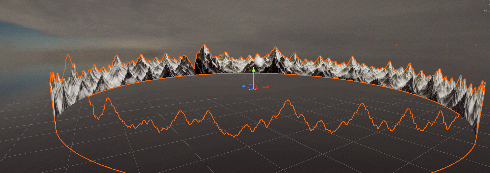

# Panorama Cylinder

## Video

Original manual technique this tool automates, by **1970kaustin**:

- [Pano cylinder creation walkthrough, part 1](https://www.loom.com/share/7f5c89629c7a40ccbaf5a445de62cd01)
- [Pano cylinder creation walkthrough, part 2](https://www.loom.com/share/a2a0f21b22774225841e6fb461313715)

## Description

Takes some of the manual work out of pano cylinder creation. Arranges a
set of separate panorama tile images (each a transparent-background PNG,
e.g. a Meshy AI mountain range render) around the inside of a cylinder —
one tile per equal angular slice — so they stitch into a seamless 360°
backdrop. Similar in spirit to `SkyDome` (an inside-out mesh meant to be
viewed from a camera near its center), but for a set of discrete tile
images instead of one wraparound equirectangular texture.

This automates the geometry/UV side of a technique originally shown
manually by **1970kaustin** — see the Video section above for the
original walkthroughs this tool is based on.

## Installation

**Option A — import the `.unitypackage`** (easiest): download the latest
`.unitypackage` from this repo's
[Releases page](https://github.com/mmoore0011/chickenandribs_panorama_cylinder/releases/latest),
then in Unity: **Assets → Import Package → Custom Package…** and select
the downloaded file.

**Option B — copy into your project**: copy the `panorama_cylinder`
folder's contents into your Unity project's `Assets/` (the `.shader` file
and `Scripts/` folder need to be somewhere Unity compiles normally;
`Editor/` needs to be — as always — inside a folder literally named
**Editor**).

Either way, the tool appears under **Tools → chickenandribs → Panorama
Cylinder**.

## Step-by-Step Instructions

1. **Tools → chickenandribs → Panorama Cylinder → Create Spawner.** This
   drops a `Panorama Cylinder` object into the scene with a
   `PanoramaCylinderSpawner` component.
2. In the Inspector, add your tile images **in stitching order** under
   **Tiles** (tile 0 first, tile 1 next to it, and so on around the ring).
   There's no separate "how many segments" field — the number of tiles you
   add *is* the segment count, so degrees-per-segment (`360° / tile count`)
   adjusts automatically.
3. As soon as tiles are assigned, segment meshes appear live in the Scene
   view as children of the spawner. Every field below — Radius, Height,
   Bottom Y, Curve Subdivisions, Start Angle, and especially **Overlap
   Degrees** — rebuilds that preview live as you edit it, so you can drag
   a slider and watch the result instead of guessing values and re-baking
   to check.
4. **Overlap Degrees** is the seam-blend control: each tile's mesh
   extends that many degrees into its neighbor's territory, fading out
   across that span, so a seam that doesn't quite line up softens into a
   blend instead of showing a hard edge. `0` = a plain hard edge at the
   tile boundary.
5. Once it looks right, select the spawner and run **Tools →
   chickenandribs → Panorama Cylinder → Bake Selected**. This saves one
   mesh + one material per tile under `Assets/PanoramaCylinder/`, plus
   the whole ring as a reusable prefab — this is what actually ships; the
   spawner's own live preview children are editor-only (never saved with
   the scene, never present in a build).

## Troubleshooting

- **A faint line is visible along the top of the cylinder, in otherwise-
  empty sky** — this is an anti-aliasing artifact on the mesh's own
  silhouette edge, not a real hole. Try raising **Curve Subdivisions**
  (especially important with very few tiles, since the facet count is
  shared across the whole 360° ring), and/or reducing **Height** so less
  purely-transparent geometry extends above your actual tile content.
- **Overlap Degrees doesn't visibly blend the seam, or looks
  "ghosted"/see-through in the overlap zone** — make sure you're on a
  current build; an earlier version of this tool's shader had a
  known alpha-compositing bug here that's since been fixed.
- **The source tiles just don't line up no matter how much Overlap you
  add** — Overlap Degrees blends a *small* misalignment; it can't fix a
  large mismatch in horizon height or terrain color between two
  independently-generated tiles. That needs a source-image fix (e.g.
  touching up the seam directly in an image editor) rather than more
  overlap.
- Each segment's material uses this tool's own **Custom/PanoramaCylinderBlend**
  shader rather than a built-in one, since it needs to both clamp UVs at
  each tile's edge and apply the vertex-alpha overlap fade — a plain
  `Unlit/Transparent` can't do either.

## Feature Requests / Bug Reports

Please open an issue in this repository.
